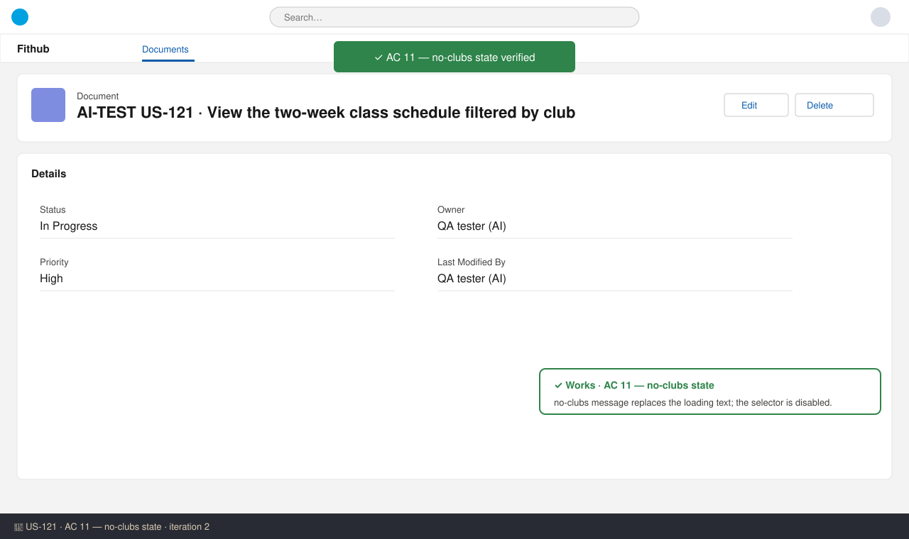

# US-121 — Test report (iteration 2)
**Verdict:** ✅ Approved with notes · **Tester:** Cuélebre · **Date:** 2026-10-31

## Summary
| Check | Result | Evidence |
|---|---|---|
| AC 1–10 | ✅ static review (unchanged since iteration 1) | api module files and tests |
| AC 11 — empty club list (finding 1) | ✅ Fixed | SchedulePage.tsx, SchedulePage.test.tsx |
| AC 11 — /schedule route, redirect, link (finding 2) | ⛔ Blocked | Router files are not on this branch (US-118/US-120) |
| Checks gate | ⛔ Blocked | "No checks configured" |

## Checks
### AC 11: empty club list — ✅ Works
**Steps:** read SchedulePage.tsx and its test.
**Expected:** a defined state when `listClubs()` returns `[]`, plus a test. **Found:** a `no-clubs` state shows "There are no clubs to show a schedule for yet.", the selector is disabled, and `getSchedule` is not called. The test asserts all three and that the loading text is absent.

## Not tested
- The `/schedule` route, the `/` → `/schedule` redirect and the AppHeader link. The ticket lists them as not done, and they belong to US-118/US-120. Add them when those stories merge.
- Nothing was compiled or run, because no checks are configured. The branch cannot build until US-117/118/120/122 are merged. Re-run the api and web tests after the merge.
