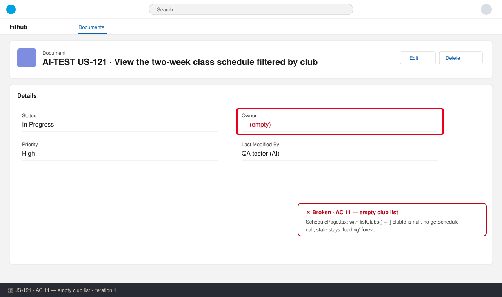

# US-121 — Test report (iteration 1)
**Verdict:** ❌ Changes requested · **Tester:** Cuélebre · **Date:** 2026-10-31

Method: static review only. `run_checks` returned "No checks configured", and the developer ran no tests. Nothing was compiled, linted or executed.

## Summary
| Check | Result | Evidence |
|---|---|---|
| AC 1 Two-week window | ✅ | schedule-window.ts, repository.ts (`>` from, `<=` to) |
| AC 2 Club filter | ✅ | repository.ts |
| AC 3 Free places | ✅ | toScheduleItem, ClassCard |
| AC 4 Own status | ✅ | repository.ts join on session member id |
| AC 5 Invalid club | ✅ | schedule.dto.ts, service.ts (error body relies on the global error handler, not on this branch) |
| AC 6 Empty state | ✅ | SchedulePage.tsx |
| AC 7 Cancelled | ✅ | ClassCard.tsx |
| AC 8 Order / local time | ✅ | repository.ts, time.ts |
| AC 9 Period narrowing | ✅ | schedule-window.ts, schedule.dto.ts |
| AC 10 Auth / minimisation | ✅ | routes.ts, DTO (401 before validation relies on the global authHook, not on this branch) |
| AC 11 Selector and states | ❌ | SchedulePage.tsx |
| Checks gate | ⛔ | no checks configured |

## Checks
### AC 11: UI club selector and states — ❌ Broken
**Steps:** read SchedulePage.tsx for the case where `listClubs()` resolves to `[]`.
**Expected:** the page shows a defined state (message or error).
**Found:** `clubId` stays null, no schedule request is made and the state stays `loading`, so "Loading schedule…" shows forever. SchedulePage.test.tsx has no test for this case. The `/schedule` route is also not registered anywhere on the branch.

## What to do
- AC 11: handle an empty club list in SchedulePage.tsx. Show the error state or a plain message instead of loading forever, and add a test for it.
- AC 11: register the `/schedule` route inside `RequireAuth` once the router files exist, so the page can be opened. Merge with US-118/US-120 and verify the imports.

## Not tested
- Checks gate: no checks are configured, so typecheck, lint, tests and build never ran. The branch imports modules that do not exist on it (`buildApp`, auth, db schema, test helpers, `apiFetch`, `useAuth`). All tests are unexecuted, so every ✅ above is a static finding.
- The error-body shape for 400/404 and the 401-before-validation ordering depend on global modules that are not on this branch.
